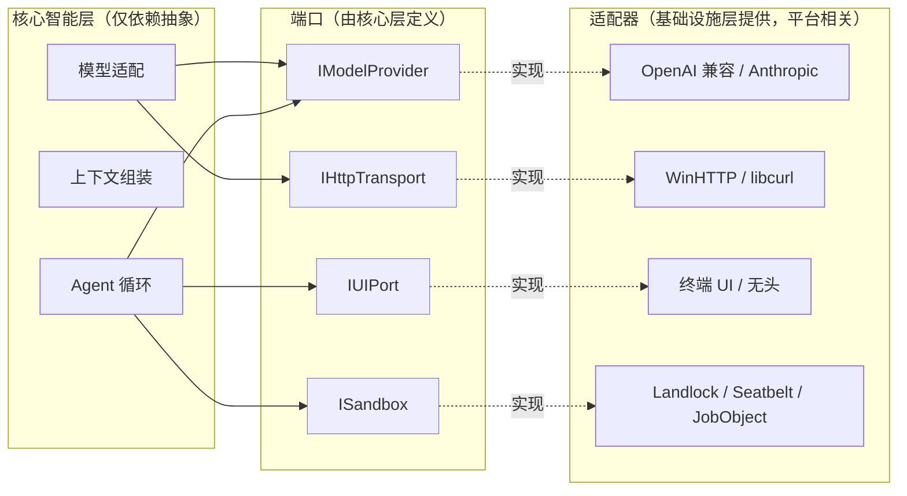

# AgentForge 总体设计说明书

| 项 | 内容 |
|---|---|
| 文档编号 | HLD-AgentForge-v1.1 |
| 版本 | v1.1 |
| 状态 | 已基线化 |
| 编制阶段 | L1 |
| 上游依据 | [`01-需求规格说明书.md`](01-需求规格说明书.md) |
| 下游文档 | L2 [`01-模块设计说明书.md`](../L2-模块设计与核心契约/01-模块设计说明书.md)，其分层与架构决策须与本文档一致 |

> 本文档记录系统的总体结构、关键设计决策及其代价。
> 每一项决策均须给出被否决的备选方案与否决理由；
> 未记录代价的决策不具备评审价值。

---

## 1. 引言

### 1.1 编写目的

本文档定义 AgentForge 的总体结构、分层与依赖规则、外部接口抽象方式，
以及若干关键设计决策的背景、理由、后果与备选方案，
作为模块设计与实现的约束依据。

### 1.2 适用范围

本文档覆盖架构风格选型、系统分层、端口抽象、运行控制流、出错处理策略、
安全结构与可扩展性设计。各模块的内部结构与接口定义在《模块设计说明书》中给出。

### 1.3 参考文献

| 编号 | 文献 |
|---|---|
| R-1 | [`01-需求规格说明书.md`](01-需求规格说明书.md) |
| R-2 | [`骨架.md`](../../骨架.md) —— 13 模块全景、W1–W4 核心机制 |
| R-3 | 六边形架构（端口与适配器）；《Designing Data-Intensive Applications》 |
| R-4 | Landlock / seccomp / Seatbelt / Windows Job Object 官方文档 |

### 1.4 术语与缩略语

术语沿用《需求规格说明书》§1.5。本文档补充以下条目：

| 术语 | 定义 |
|---|---|
| 端口（Port） | 由核心层定义的抽象接口，用于隔离不受本系统控制的外部实体 |
| 适配器（Adapter） | 端口的具体实现，位于基础设施层，与平台或厂商相关 |
| 闸门（Guardrail） | 循环中用于强制终止或限制执行的判定点 |
| 上下文层 | 上下文的组成部分，按变化频率划分并分别分配预算 |
| 降级链 | 内容超出预算时，按语义完整度递减的有序退让序列 |
| ADR | 架构决策记录（Architecture Decision Record） |

---

## 2. 设计目标与质量属性权衡

### 2.1 设计目标

设计目标由非功能需求提炼，按优先级排列。

| 优先级 | 目标 | 判据 | 来源需求 |
|---|---|---|---|
| P0 | 安全 | 模型请求执行任意命令均不造成授权范围外的破坏 | NFR-1 |
| P0 | 可扩展 | 增加工具、更换模型、更换平台时核心改动量为 0 | NFR-5 |
| P1 | 成本可控 | 长会话成本可预测、可归因、可解释 | NFR-2 |
| P1 | 可恢复 | 所有失败转换为可处理的 observation，不导致会话终止 | FR-8 |
| P2 | 响应体验 | 流式输出、界面不阻塞、执行可中断 | NFR-4 |
| P2 | 可审计 | 会话可完整回放 | NFR-3 |

设计目标中未列入"功能完备性"。功能可增量补充，
架构缺陷的修复需要返工，二者的代价不对等，故功能扩展不作为优先级项。

### 2.2 目标间的冲突与取舍

| 冲突 | 取舍 | 处置位置 |
|---|---|---|
| 安全与能力 | 保留完整的命令执行能力，同时接受 `Bash` 成为最危险入口；以双层约束对冲 | ADR-2、ADR-4 |
| 成本与信息完整 | 优先减少进入上下文的内容，其次才考虑压缩；接受压缩引入的摘要偏差 | ADR-5、NFR-2 |
| 灵活性与可预测性 | 控制流交由模型决定，因而无法保证"某事必定发生"；以引导与闸门兜底，不作硬保证 | ADR-1、§6 |
| 抽象与实现复杂度 | 仅为存在两种及以上实现的外部实体建立端口；单一实现的抽象不予引入 | §4.1 |

---

## 3. 总体架构

### 3.1 架构风格选型

#### 3.1.1 候选方案对比

| 方案 | 控制流决定方 | 处理未知任务的能力 | 可预测性 | 结论 |
|---|---|---|---|---|
| 流水线（Pipeline） | 代码，阶段固定 | 不具备 | 高 | 否决 |
| DAG 编排 | 人，图预先绘制 | 受限，图错误即阻塞 | 高 | 否决 |
| 循环 + 插件 | 模型，每次响应决定 | 具备 | 低，需以闸门补足 | **采用** |

#### 3.1.2 已否决方案的失效场景

**流水线方案的失效场景**

任务："定位并修复 `test_auth` 失败的原因"。流水线的阶段划分为
`解析 → 定位 → 修改 → 验证`。若模型在"定位"阶段提出需先查看
`conftest.py` 中 fixture 的定义，则该步骤无法归入既有阶段：
归入"定位"则定位阶段自身退化为循环，归入"解析"则解析阶段退化为循环。

由此得出结论：只要允许模型在执行中提出新的信息需求，
任何固定阶段划分都会退化为循环。

**DAG 方案的失效场景**

同一任务。绘制 DAG 需要预先确定修改的文件集合与修改顺序，
而该信息正是任务待求解的结果，无法在执行前获得。
DAG 适用于流程已知、仅需自动化的场景，不适用于探索性场景。

此外，DAG 作为静态结构，不支持模型在执行中判定当前路径不可行并改道。

#### 3.1.3 选定方案的控制流

选定"循环 + 插件"方案，其核心控制流如下：

```
输入：用户任务
将任务追加至消息列表

循环：
  (1) 响应 = 调用模型(消息列表)
  (2) 若响应中不含工具调用：
          输出响应文本
          退出循环                      // 任务结束
  (3) 对响应中的每个工具调用：
          结果 = 执行工具(调用)          // 失败亦作为结果
          将 调用 与 结果 追加至消息列表
  (4) 回到 (1)
```

上述控制流是系统的核心执行结构，其余模块均服务于其中的某个环节：

| 目标 | 所需模块 | 介入位置 |
|---|---|---|
| 观测更准确 | ⑥ 工具、③ 仓库索引 | 步骤 (3) |
| 行动更安全 | ⑧ 权限门、⑧ 沙箱 | 步骤 (3) 之前及其内部 |
| 执行可持续 | ④ 上下文组装、压缩 | 步骤 (1) 之前 |
| 防止失控 | 六道闸门、重复调用检测 | 循环条件 |
| 支持中断 | 取消传播 | 全局 |
| 支持审计 | ⑫ 会话存储 | 步骤 (3) 的追加动作 |

### 3.2 系统总体结构

系统分为三层，模块编号沿用 `骨架.md` 的 13 模块全景。

```
┌──────────────────────────────────────────────────────────────┐
│ 交互执行层                                                    │
│   ⑥ 工具调用与执行  ·  ⑪ UI 与交互  ·  ⑬ 测试与评估          │
└───────────────────────────┬──────────────────────────────────┘
                            │ 依赖
                            ▼
┌──────────────────────────────────────────────────────────────┐
│ 核心智能层                                                    │
│   ⑦ Agent 循环  ·  ② 多模型适配  ·  ④ 上下文组装             │
│   ③ 仓库索引    ·  ⑤ 增量状态                                │
│                                                               │
│   本层仅依赖端口抽象，不感知任何具体实现                       │
└───────────────────────────┬──────────────────────────────────┘
                            │ 依赖
                            ▼
┌──────────────────────────────────────────────────────────────┐
│ 基础设施层                                                    │
│   ① 插件管理  ·  ⑧ 安全与权限  ·  ⑨ 可观测性                 │
│   ⑩ 配置      ·  ⑫ 持久化与记忆                              │
│   ＋ 第 0 个模块：types.hpp（类型契约）· HTTP 传输抽象 · JSON │
└──────────────────────────────────────────────────────────────┘
```

各层模块职责见《模块设计说明书》§2.2。

### 3.3 模块归属判据

模块归属的判据不是"距离用户的远近"，而是"该模块依赖什么、知道什么"。
据此，⑧ 安全与权限、⑫ 持久化与记忆归入基础设施层，即便其调用方位于上层：

| 模块 | 判据 |
|---|---|
| 沙箱 | 调用操作系统原语（Landlock / Seatbelt / Job Object），属平台相关能力 |
| 权限门 | 仅认识 `(ToolDef, args)` 抽象，不认识任何具体工具 |
| 会话存储 | 仅负责读写 JSONL / SQLite，不感知循环与界面 |

将上述模块置于下层，可保证更换界面实现或更换沙箱实现时不波及上层。

### 3.4 依赖规则与检验方法

| 编号 | 规则 | 违反后果 |
|---|---|---|
| R1 | 依赖方向单向：交互执行层 → 核心智能层 → 基础设施层 | 修改界面组件需要改动模型适配层 |
| R2 | 核心层仅依赖端口抽象，不依赖具体实现 | 增加一种沙箱实现需改动循环内核，违反 NFR-5 |
| R3 | `types.hpp` 位于最底层，不依赖任何项目内文件 | 产生循环依赖，需以前向声明规避或无法编译 |

**R3 的实证案例**：初始实现将 `Turn` 定义于 `agent_loop.hpp`，
而 `context_budget.hpp` 需要该类型，且 `agent_loop.hpp` 又包含
`context_budget.hpp`，构成循环依赖。处置方式不是添加前向声明，
而是将 `Turn` 下沉至 `types.hpp`。该案例在 L2 展开。

**检验方法**：对任一模块依次核验以下三项：

1. 该模块是否感知界面的存在 —— 若感知，R1 被破坏；
2. 该模块是否包含具体实现头文件（如 `http_winhttp.hpp`） —— 若包含，R2 被破坏；
3. 该模块是否被 `types.hpp` 依赖 —— 若是，R3 被破坏。

---

## 4. 接口设计

### 4.1 外部接口与端口抽象

系统定义四个端口，对应《需求规格说明书》§2.4 所界定的四个不受控外部实体。
每个端口均须具备两种及以上实现，否则该抽象不成立。



端口数量由外部实体数量决定，不由设计模式偏好决定：
不受本系统控制的部分必须可被替换。

### 4.2 内部接口约定

| 约定 | 内容 |
|---|---|
| 共享类型 | 跨模块共享的类型定义置于 `types.hpp`，不在各模块头文件内重复定义 |
| 失败表达 | 失败以返回值表达（携带 `isError` 或错误块），不跨模块抛出异常 |
| 接口演进 | 接口只增不改；新增能力通过扩展字段或新增接口实现，不修改既有调用方 |
| 插件边界 | 跨动态库边界仅传递 C 兼容类型，详见 ADR-3 |

---

## 5. 关键设计决策

### ADR-1 上下文采用扁平消息列表，控制流由模型驱动

| 项 | 内容 |
|---|---|
| 状态 | 已接受 |
| 编制阶段 | L1 |

**背景**

任务通常需要多步执行。多步任务的步骤序列或由代码预先确定，
或在执行过程中动态决定。已有产品两种做法并存：
图先行（LangGraph 类）与运行时循环（Claude Code、Codex CLI 类）。

**决策**

上下文表示为一个仅追加的扁平 `Message` 列表。每轮将模型的工具调用
与工具结果追加至该列表，控制流由"本轮响应是否包含工具调用"驱动。
不引入任何图结构。

**理由**

1. 与模型 API 的数据形状一致。主流 API 的 `messages` 即为扁平数组。
   引入图结构将导致每次请求执行一次"图 → 消息列表"的转换，属额外复杂度。
2. 顺序携带语义。消息列表本身构成完整因果链，
   压缩、提示缓存与审计回放均依赖该性质。
3. 在探索性任务中，图是执行产物而非输入，见 §3.1.2。

**后果 —— 收益**

- 可处理执行前未知的任务，这是 Agent 相对自动化流程的主要优势；
- 具备完整回放能力：给定消息列表即可重建当时的状态；
- 压缩与缓存机制可直接实现为列表操作。

**后果 —— 代价**

- 无法保证特定动作必定发生。例如"修改后必须运行测试"只能通过
  引导与闸门兜底，无法在结构上强制。
- 不支持并行分支。同一列表内无法同时推进两条路径，
  需借助子代理各持一条列表实现。
- 长会话中列表持续增长，必须依赖压缩管理，该问题在 L7 处置。

**已否决的备选方案**

| 方案 | 否决理由 |
|---|---|
| DAG / 状态图编排 | 图须预先绘制，而探索性任务的图即求解结果；且模型无法中途改道 |
| 事件溯源 + 投影 | 灵活性高，但每次请求均需投影出消息列表，复杂度与性能代价超过收益 |
| 树结构（支持分支回溯） | 理论上支持回滚重试，但与 API 数据形状不符，且界面难以表达；实践中以重开一轮即可替代 |

**可逆性**：低。该决策位于系统最底层，变更等同于重写。

---

### ADR-2 工具是原语，不是集成

| 项 | 内容 |
|---|---|
| 状态 | 已接受 |
| 编制阶段 | L1 |

**背景**

编码任务所需能力众多：读取文件、修改文件、执行测试、安装依赖、
版本控制操作、接口调用、文档查询等。需决定是为每类任务提供专用工具，
还是仅提供基础原语。

**决策**

仅提供原语级工具：`Read`、`Write`、`Edit`、`Bash`、`Grep`、`Glob`
（L11 增加 `Task`）。所有集成行为（执行 pytest、安装依赖、提交变更）
通过 `Bash` 组合完成。

**理由**

1. 组合方向有利。6 个原语可组合出无限种行为；
   M 个专用集成仅能完成 M 类任务，且需维护 M 份代码。
2. 集成会随生态演进而失效。包管理器与测试框架的更替会使写死的集成腐烂，
   原语不受影响。
3. 安全边界可收敛。执行能力集中到 `Bash` 一处，权限规则与沙箱只需约束该处。
   若提供 20 个集成入口，安全审查需覆盖 20 处，遗漏风险随之上升。
4. 提示词稳定，有利于缓存命中。工具列表属于缓存前缀的一部分，
   集成数量持续增长将使前缀频繁变动，导致缓存无法命中。

**后果 —— 收益**

- 新场景通常无需新增工具，通过 `Bash` 组合即可覆盖；
- 权限与沙箱实现简单、可审计；
- 工具表规模小且稳定，缓存命中率与模型选择准确率较高。

**后果 —— 代价**

- 执行步数增加。专用工具可一步完成的操作，通过 `Bash` 组合需 2 至 3 步，
  成本更高、耗时更长。
- 对引导内容的依赖增强。模型需获知项目使用的测试框架等信息，
  否则会产生无效尝试，由此推出项目知识文件（`CLAUDE.md` / `AGENTS.md`）的必要性。
- `Bash` 成为最危险的入口。能力集中便于防守，但该处一旦被绕过即整体失守，
  由此推出 ADR-4。

**已否决的备选方案**

| 方案 | 否决理由 |
|---|---|
| 为每个生态提供专用工具 | 维护量随语言、包管理器、测试框架数量增长，不可收敛，且持续失效 |
| 仅提供 `Bash` 单一工具 | 具备能力但失去可约束性：缺少结构化文件修改，无法执行精确差异比对与细粒度权限（如"允许读 src/，禁止读 .env"不可表达） |
| 由模型生成代码后执行 | 表达力最强，但安全模型失效（任意代码无边界），且无法实施权限门；本项目明确排除 |

**可逆性**：中。可增量补充专用工具，但集成数量一旦失控，收敛困难。

---

### ADR-3 插件接口采用纯 C ABI

| 项 | 内容 |
|---|---|
| 状态 | 已接受 |
| 编制阶段 | L1 |

**背景**

工具需支持以动态库形式扩展（`tools/*.dll`、`*.so`）。宿主与插件为两个
独立编译的二进制模块，需定义跨边界的数据交换方式。

**决策**

插件接口采用纯 C ABI：

- 导出函数一律声明为 `extern "C"`，禁止 C++ 名称修饰；
- 仅传递 C 兼容类型（`const char*`、`int`、函数指针）；
- 不跨边界抛出异常，以返回值与错误串表达失败；
- 遵循"谁分配谁释放"：宿主提供 `af_free_string`，
  插件不得返回自行分配的指针交由宿主释放。

**理由**

1. C++ 不具备稳定 ABI。同一编译器在标准库版本、优化级别、
   `_ITERATOR_DEBUG_LEVEL` 等配置变化下，`std::string` 的内存布局可能不同。
   跨边界传递 C++ 标准库类型属未定义行为，其症状通常在特定环境才显现。
2. C ABI 是跨语言的公共子集。C、Rust、Go、Python cffi 均可生成 C ABI 插件，
   插件生态不必受限于 C++。
3. 进程外插件的隔离收益不足以抵消其成本，见已否决方案。

**后果 —— 收益**

- 插件可使用任意语言、任意编译器、任意 C++ 标准编写；
- 宿主升级编译器不会导致既有插件失效；
- 边界清晰可审计，跨边界仅传递字符串。

**后果 —— 代价**

- 接口表达冗长。无法传递 `std::vector`、`std::optional` 与异常，
  结构化数据须序列化为 JSON 字符串并在边界另一侧解析。
- 内存管理需显式约定，并提供释放函数。
- 类型安全减弱。边界处结构化数据退化为 `const char*`，失去编译期检查。
- ABI 不匹配常表现为静默错误或难以定位的崩溃，
  故必须实施 ABI 版本号校验（`abiVersion` 字段），不匹配则拒绝加载。

**已否决的备选方案**

| 方案 | 否决理由 |
|---|---|
| C++ 虚基类跨库 | ABI 不稳定；要求插件与宿主使用完全一致的编译器与运行库配置，实践中不可行 |
| 进程外插件（stdio / JSON-RPC） | 隔离性最佳，但每次调用存在进程启动开销，无法传递流式结果，部署复杂，且权限模型需重新设计 |
| 运行时脚本（Lua / WASM） | 安全性与可沙箱性较好，但表达力与性能受限，且引入新的运行时依赖 |
| 不开放插件，仅支持内置工具 | 最简单，但违反 NFR-5（增加工具需改动核心） |

**可逆性**：较高。内部工具与外部插件共用同一套 `ToolDef` 描述，
后续更换加载方式只需替换 `loadPlugin` 一层。

---

### ADR-4 安全边界落在内核层，权限门为第一道防线

| 项 | 内容 |
|---|---|
| 状态 | 已接受 |
| 编制阶段 | L1 |

**背景**

`Bash` 工具使模型具备执行任意命令的能力（ADR-2 的代价）。
需确定约束该能力的机制。已有产品给出了不同答案：
Claude Code 采用应用层权限门，Codex CLI 采用操作系统级沙箱。

**决策**

两层机制同时采用，职责分离：

| 层 | 位置 | 回答的问题 | 实现 |
|---|---|---|---|
| 权限门（Gate） | 应用层 | 是否需要请求用户授权 | 规则匹配 → deny / ask / allow |
| 沙箱（Sandbox） | 内核层 | 授权后是否仍受强制约束 | Landlock + seccomp / Seatbelt / Job Object |

关键约定：

1. deny 规则在求值时始终优先于 allow（排序时强制置于最前）；
2. 沙箱为强制机制，权限门放行不等于沙箱放行；
3. 被拦截不视为失败崩溃，而作为 observation 返回，且须携带可解释原因
   （如"网络已被禁用"而非原始错误码），并明确告知该结果不因重试而改变。

**理由**

1. 应用层路径检查存在已知的绕过方式，包括：符号链接
   （允许写 `./out/x` 而 `./out` 指向 `/etc`）、相对路径逃逸（`../../..`）、
   经由其他程序（`python -c "open('/etc/passwd','w')"`）、
   自写脚本后执行（检查了 `sh -c` 而未检查 `bash script.sh`）、
   以及 `/proc/self/cwd` 一类特殊路径。
   在应用层穷尽上述情形所需的工作量，与内核层一条规则相当。
2. 内核层不可绕过。Landlock 在 `restrict_self` 之后，进程自身亦无法重新放开，
   其语义强于应用层的可撤销检查。
3. 仅设权限门无法无人值守运行；仅设沙箱则所有情形均需预设策略，体验受损。
   两者互补。

**后果 —— 收益**

- 应用层遗漏的路径由内核层兜底；
- 支持无人值守运行：沙箱提供安全下限，权限门仅需处理权限扩大请求；
- 安全策略可审计，内核层规则集为显式声明。

**后果 —— 代价**

- 需为三个平台分别实现（Linux Landlock+seccomp、macOS Seatbelt、
  Windows Job Object + AppContainer），且三者能力不等价，
  因而需要 `ISandbox` 端口与能力探测（`selfCheck`）。
- 沙箱拦截通常表现为静默失败（返回 `EACCES` / `EPERM`），
  缺乏指向沙箱的线索，故沙箱实现必须记录 `blockReason`。
- 与正常需求存在冲突，例如安装依赖时网络被禁，
  需引入临时提权机制，而提权行为本身须纳入审计。
- Windows 缺少与 Landlock 对等的、不可逆的文件系统限制原语；
  Job Object 管理进程树与资源，不约束文件路径。
  **Windows 上的沙箱能力弱于 Linux，该差异应在文档中明示，
  不得表述为等价。**

**已否决的备选方案**

| 方案 | 否决理由 |
|---|---|
| 命令字符串黑名单 | 存在等价变体（`rm -r -f`、`rm${IFS}-rf`、`find . -delete`、自写脚本等），无法构成完备约束 |
| 仅在容器中运行（Docker） | 隔离性强，但要求用户预装 Docker，冷启动开销大，且与"修改本地工作区文件"的核心需求冲突（挂载卷后回到同一问题） |
| 仅设权限门 | 无法无人值守；用户授权后不存在第二道防线 |
| 以独立用户身份运行子进程 | 在 Linux/macOS 上有效且简单，但需 root 预配置，Windows 不可用；可作为沙箱的补充，不能替代 |

**可逆性**：中。沙箱实现可后续补充（端口已预留），
但权限门的求值顺序（deny 优先）一旦变更将影响大量测试，须一次确定。

---

### ADR-5 上下文分层组装，附带预算与降级链

| 项 | 内容 |
|---|---|
| 状态 | 已接受 |
| 编制阶段 | L1 |

**背景**

每次请求需携带的内容来源包括：system 提示、项目知识、仓库地图、
检索结果、当前编辑文件、对话历史与当前用户输入。
而窗口存在硬上限（C-1），成本按 token 计量（NFR-2）。

**决策**

将上下文划分为 7 层，按层分配预算，超出预算时按降级链退让：

| 层 | 内容 | 变化频率 | 预算策略 |
|---|---|---|---|
| L0 | system 提示 | 几乎不变 | 不裁剪 |
| L1 | 项目知识（`CLAUDE.md`） | 会话内不变 | 设上限，超出截断 |
| L2 | 仓库地图 | 按需刷新 | 按剩余预算动态调整 |
| L3 | 检索命中片段 | 每步变化 | 按预算比例分配 |
| L4 | 活动文件 | 编辑后立即失效 | 优先保证 |
| L5 | 对话历史 | 每步增长 | 自尾部保留 |
| L6 | 当前用户输入 | — | 不裁剪 |

降级链（内容超出预算时的退让顺序）：

```
全文 → 仅函数签名 → 符号名 + 路径 → 仅路径 → 丢弃
```

两条不变量：

- L0 至 L2 须保持字节级稳定，否则提示缓存无法命中；
- L6 始终位于最后且保持完整。

**理由**

1. 各层的变化频率相差数个数量级，这是分层的根本依据。
   将"几乎不变"与"每步都变"的内容拼接为单一字符串，
   将导致每次请求的缓存前缀均不相同，命中率为零。
   缓存按前缀匹配，前缀变化即其后全部失效。
2. 分层后可定位成本来源（历史过长、还是仓库地图过大）。
3. 降级须有序。直接截断会产生"半个函数"一类有害内容；
   按"签名 → 符号名 → 路径"降级可保留语义线索。

**后果 —— 收益**

- 成本可预测、可解释：每层具备配额与度量；
- 长会话通过压缩与大结果落盘保持可控；
- 提示缓存可实际命中（L0 至 L2 稳定）。

**后果 —— 代价**

- 上下文组装器成为系统中最复杂的模块，需掌握各层内容、预算与降级策略，
  并维护"工具结果不得孤立出现"一类合法性不变量。
- 缓存前缀不变量需持续维护。任何向 system 段添加动态信息的改动
  都会静默破坏缓存，其表现仅为成本上升，不产生错误。
- 分层本身不消除成本：以模型生成摘要的压缩需额外调用，
  故须设置阈值与抖动保护，避免在边界反复压缩。
- L5 自尾部保留在极端情形下会丢失初始任务目标，
  故压缩时必须单独保留任务目标，该规则须显式实现。

**已否决的备选方案**

| 方案 | 否决理由 |
|---|---|
| 全部置于 `messages` 而不分层 | 无法控制与解释成本，缓存命中率为零 |
| 纯滑动窗口（仅保留最近 N 条） | 实现简单，但会丢失初始需求与关键发现，导致模型重复绕行 |
| 以全量向量检索替代分层 | 检索解决"定位相关代码"，不解决 system 段与历史的放置问题；且中文与符号检索质量不稳定 |
| 由用户手工管理上下文 | 将复杂度转移给用户，且无法应对长会话的自然增长 |

**可逆性**：中。层的数量可增减，
但"L0 至 L2 字节级稳定"这一不变量一旦破坏，缓存收益将永久丧失。

---

## 6. 出错处理设计

### 6.1 错误分类

| 类别 | 典型情形 | 来源 |
|---|---|---|
| 工具执行失败 | 命令返回非零退出码、文件不存在 | FR-8 |
| 模型请求失败 | 限流、网关错误、超时、连接中断 | C-5 |
| 参数解析失败 | 半截 JSON、字段名偏离、类型不符 | C-7 |
| 授权拒绝 | 权限门判定为 deny，或用户拒绝 | FR-7 |
| 强制拦截 | 沙箱拒绝访问，返回 `EACCES` / `EPERM` | ADR-4 |
| 编码异常 | 外部字节流非 UTF-8 或含控制字符 | C-4 |
| 用户中断 | 执行过程中收到中断信号 | FR-5 |

### 6.2 处理原则

1. **失败即观察结果**。任何失败均转换为携带原因的 observation 回写上下文，
   不以异常向上抛出，不终止会话（FR-8）。
2. **原因可解释**。返回给模型的原因须指明约束来源，
   而非透传系统错误码（ADR-4 约定 3）。
3. **重试可判定**。错误须标注是否可重试：
   网络类错误可重试，授权拒绝与沙箱拦截不可重试，
   且须明确告知重试不改变结果，以避免模型重复尝试。
4. **降级须声明**。可选依赖缺失时降级到备用实现，
   并向用户与日志显式声明降级事实，不得静默降级。

### 6.3 重试与终止策略

| 策略 | 规则 |
|---|---|
| 请求重试 | 指数退避叠加抖动，避免同步重试造成拥塞（C-5） |
| 重复调用检测 | 对内容等价的重复工具调用计数，超过阈值即终止，防止无进展循环（C-2） |
| 闸门终止 | 循环中设置六道闸门（步数、预算、时间、重复、授权、中断），任一项触发即终止 |
| 中断传播 | 中断信号传播至当前工具调用与子进程，终止后输出已完成步骤（FR-5） |

---

## 7. 安全设计

安全结构遵循 ADR-4 的双层模型。

| 层 | 机制 | 不可绕过性 |
|---|---|---|
| 应用层 | 权限门规则匹配，deny 优先求值 | 可被绕过，故不作为唯一防线 |
| 内核层 | Landlock + seccomp / Seatbelt / Job Object | 不可逆降权，进程自身无法撤销 |

设计要点：

1. 默认姿态为最小权限：默认仅可读写工作区，无网络访问（NFR-1）。
2. 只读操作同样受约束，密钥类文件的读取应被拒绝。
3. 文件修改前应生成检查点，支持还原。
4. 全部权限判定结果须写入审计记录（NFR-3）。
5. 跨平台能力差异须在文档中明示，不得将不同平台的实现表述为等价。

---

## 8. 可维护性与可扩展性设计

| 目标 | 手段 | 依据 |
|---|---|---|
| 扩展不改核心 | 端口与适配器：为核心层依赖的每个外部实体定义端口，实现置于基础设施层 | NFR-5、§4.1 |
| 插件跨编译器可用 | 插件接口采用纯 C ABI，并实施 ABI 版本号校验 | ADR-3 |
| 消除循环依赖 | 共享类型下沉至 `types.hpp`，该层不依赖任何项目内文件 | R3、§3.4 |
| 接口演进安全 | 接口只增不改，新增能力通过扩展字段或新增接口实现 | §4.2 |
| 可离线测试 | 提供可注入的假服务端，协议层逻辑可在无网络、无调用成本下验证 | NFR-6 |
| 可诊断 | 结构化日志、请求追踪与用量统计；降级与拦截均须记录原因 | NFR-3、ADR-4 |

---

## 9. 设计约束与未决问题

### 9.1 已确定的设计约束

| 编号 | 约束 |
|---|---|
| D-1 | 上下文控制流为仅追加的扁平消息列表，不引入图结构（ADR-1） |
| D-2 | 工具集限定为原语级，集成行为通过 `Bash` 组合实现（ADR-2） |
| D-3 | L0 至 L2 须保持字节级稳定，任何向 system 段注入动态信息的改动均禁止（ADR-5） |
| D-4 | 权限门求值时 deny 规则优先于 allow 规则（ADR-4） |
| D-5 | 压缩时须单独保留任务目标（ADR-5 代价条款 4） |

### 9.2 未决问题

| 编号 | 问题 | 现状 |
|---|---|---|
| U-1 | Windows 平台是否补充 AppContainer 以缩小与 Linux 的沙箱能力差距 | 当前仅实现 Job Object，文件与网络隔离未实现，能力弱于 Linux |
| U-2 | 上下文层数（7 层）在实测后是否需要调整 | 层数可增减，L0–L2 稳定性约束不变 |
| U-3 | 是否引入专用工具以缩短原语组合的步数 | 当前全部通过 `Bash` 组合，步数与成本较高 |
| U-4 | 跨会话长期记忆的检索范围与淘汰策略 | 当前仅实现会话级持久化与回放（NFR-3），长期记忆未定义 |

---

## 附录 A 设计模式对照

| 模式 | 出现位置 | 由哪条需求推出 |
|---|---|---|
| 分层架构 | §3.2 | NFR-5，稳定依赖原则 |
| 端口与适配器 | §4.1 | 四个不受控外部实体（G2 系统上下文图） |
| 工厂方法 | `createProvider()` / `createHttpTransport()` | 需按平台与配置选择实现 |
| 访问者 | `std::visit` 处理 `ChatChunk` | C-7：流式事件须穷尽处理，遗漏即静默损坏 |

本阶段仅完成变化点的识别，接口的正式定义在 L2《模块设计说明书》中给出。

---

## 附录 B 设计评审清单

进入模块设计前，本文档须通过以下检查：

| 编号 | 检查项 | 通过标准 |
|---|---|---|
| 1 | 每条需求均有承载模块 | §7 追溯矩阵无空缺项 |
| 2 | 每个模块均可指出其服务的需求 | 无法指出的模块应判定为过度设计 |
| 3 | 每个 ADR 均记录了代价 | 未记录代价的 ADR 视为未完成 |
| 4 | 每个 ADR 均记录备选方案及否决理由 | 仅记录选定方案不构成完整 ADR |
| 5 | 分层可通过 §3.4 三项检验 | 任一模块均可逐项核验 |
| 6 | 每个端口均可列举两种及以上实现 | 无法列举第二种实现的抽象应取消 |
| 7 | 循环控制流可完整复述 | 四个步骤，顺序与终止条件正确 |

> 第 6 项为关键判据：能够列举出多种实现的抽象才是必要的，
> 仅存在单一实现的抽象属过度设计。该判据在 L3 得到验证——
> `IModelProvider` 在更换协议时才引入，而非在初始阶段预先引入。
