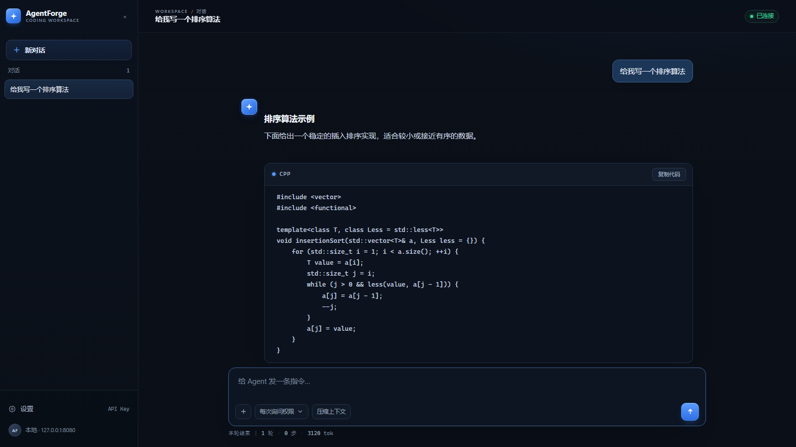

<div align="center">

# 🤖 AgentForge

### 从零开始手写一个 Windows 原生 AI 编程 Agent  
### Build a Windows-native AI coding agent from scratch

<p>
  
  
  
  
</p>

</div>

用 C++20 一步步搭出一个能读代码、改代码、运行命令的 Windows Agent。项目同时包含教程课件与逐讲源码，适合学习 Agent 的基本工作流与工程实现。

Build a Windows-native agent in C++20 that can inspect code, edit files, and run commands. The repository includes course materials and step-by-step source snapshots.



## ✨ Features / 功能

- **Streaming conversation / 流式对话：** SSE 流式解析与模型响应处理
- **Tool system / 工具系统：** 工具注册、调用与自主执行循环
- **Context management / 上下文管理：** 上下文预算与压缩
- **Execution safety / 执行安全：** 多道安全检查与 Job Object 沙箱
- **Repository understanding / 仓库理解：** 仓库索引与检索
- **Multiple interfaces / 多种交互界面：** CLI、终端 UI、Qt 桌面端与浏览器界面（按当前实现进度使用）

> **Status / 项目状态：** 当前 README 所述网页端已完成；其他界面与扩展能力仍在迭代。请以实际发布版本为准。

## 🚀 Quick Start / 快速开始

### One-line install / 一键安装

```powershell
irm https://raw.githubusercontent.com/xiaoyoumi9924/agentforge/main/install.ps1 | iex
```

启动后访问 `http://127.0.0.1:8080`。首次使用时，在页面中配置模型 API Key；默认对接 DeepSeek。

After installation, open `http://127.0.0.1:8080` and configure your model API key on first launch. DeepSeek is the default provider.

### Alternative / 备用方式

从 [Releases](../../releases/latest) 下载 `AgentForge-Web-v1.0.0.zip`，解压后运行 `run-web.bat`。

Download the packaged release, extract it, and run `run-web.bat`.

## 🧱 Project Structure / 项目结构

```text
.
├── 01-course/            # Course materials and lesson source code
├── 02-agentforge/        # Main application
│   ├── src/              # Core implementation
│   ├── gui/              # Qt 6 desktop UI
│   └── tests/            # Tests and evaluation
├── 03-text/              # Assignment implementations
├── deploy/               # Installation and release scripts
├── docs/                 # User documentation
├── install.ps1
├── install.sh
└── README.md
```

## 📚 Learning Path / 学习路线

| Stage | Topics |
|---|---|
| Design | Requirements, architecture and module contracts |
| Conversation | SSE streaming |
| Actions | Tool calls, file editing and agent loop |
| Safety | Guardrails, sandboxing and session persistence |
| Understanding | Repository indexing and retrieval |
| Interaction | Terminal and desktop interfaces |
| Delivery | Evaluation and release |

课程材料索引：[01-course/README.md](01-course/README.md)

## 📖 Documentation / 文档

- [使用手册 / User Guide](docs/使用手册.md)
- [课程材料索引 / Course Index](01-course/README.md)
- [Web 后端实现说明 / Web Implementation](03-text/08-web-ui/README.md)

## 📄 License / 许可

[MIT License](LICENSE)
