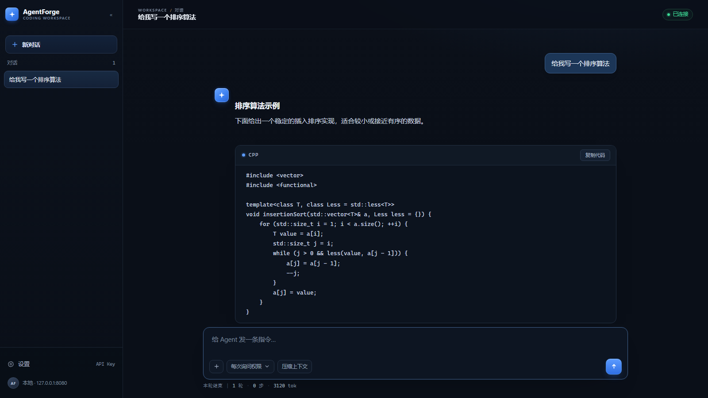

# 从零开始手写一个 AI Agent


用 C++20 一步步搭出一个能读代码、改代码、跑命令的 Windows Agent，包含详细教程和源代码。
覆盖 SSE 流式解析、工具注册表、上下文预算与压缩、六道安全闸门、Job Object 沙箱、仓库索引、
会话持久化，最后接上 CLI、终端 UI、Qt 桌面端和浏览器界面。



## 快速开始

目前是能用的完整版本：已完成网页端，其余功能继续迭代。

### 第一步：安装

目前仅支持 Windows 系统。

```powershell
irm https://raw.githubusercontent.com/xiaoyoumi9924/agentforge/main/install.ps1 | iex
```

<details>
<summary><b>备用方法</b></summary>

到 [Releases 页面](../../releases/latest) 下载 `AgentForge-Web-v1.0.0.zip`（1.2 MB），
解压到任意目录，双击 `run-web.bat` 即可运行，无需其他依赖。

</details>

### 第二步：连接模型

启动后自动打开浏览器并访问 `http://127.0.0.1:8080`，终端提示粘贴 API Key，默认对接 DeepSeek。

到这一步就装完了：一个只跑在本机的网页，你下指令，它读文件、改代码、跑命令。

## 项目结构

```
.
├── 01-course/            12 讲课件与逐讲源码
│   ├── courseware/       课件：前导 7 份 + 主线 12 讲
│   └── code/             逐讲源码 L01 … L12
├── 02-agentforge/        完整工程
│   ├── src/              核心实现
│   ├── gui/              Qt 6 桌面端
│   └── tests/            自检与端到端评测
├── 03-text/              大作业题目与实现
├── deploy/               安装与发布脚本
├── docs/                 使用手册
├── install.ps1           一键安装（另有 install.sh）
├── LICENSE               MIT
└── README.md
```

## 课程内容

7 份前导课件阐述设计取舍，12 讲主线按能力递进：

| 阶段 | 讲次 | 完成的能力 |
| --- | --- | --- |
| 设计 | L01–L02 | 需求与总体设计、模块接口契约 |
| 对话 | L03 | SSE 流式回答 |
| 行动 | L04–L05 | 工具调用、文件编辑、自主循环 |
| 约束 | L06–L07 | 六道闸门、沙箱、会话持久化 |
| 理解 | L08 | 仓库索引与检索 |
| 交互 | L09 | 终端界面 |
| 配置 | L10 | 配置文件与密钥管理 |
| 扩展 | L11 | 子代理 |
| 交付 | L12 | 评测与发布 |

每讲均附课件与对应源码快照，见 [课程材料索引](01-course/README.md)。

## 文档

- [**使用手册**](docs/使用手册.md) —— 安装细节、界面操作、任务写法、全部配置项、命令行参数、故障排查
- [课程材料索引](01-course/README.md) —— 前导课程与主线 12 讲课件、逐讲源码
- [Web 后端实现说明](03-text/08-web-ui/README.md) —— 第八题的设计与验证记录

## 许可

代码以 [MIT License](LICENSE) 开源。
